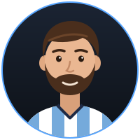

 San Antonio, TX

 

## About Me

- Recent **CS grad** who loves building apps and working on projects
- Interned at **Costco IT**, working in a large enterprise engineering environment
- I build across the stack: web apps, desktop tools, and mobile
- Always building something new, learning a new tool, or improving one of my projects

## Tech Stack

**Languages**  

  

**Frontend**  

  

**Backend & Databases**  

  

**Desktop & Mobile**  

  

**DevOps, Cloud & Tools**  

  

**Observability**  

## Featured Projects

<!--FEATURED_PROJECTS:start-->
<table>
  <tr>
    <td width="50%" valign="top">
      <h3><a href="https://github.com/borhanrahimi/linkwell">Linkwell</a></h3>
      A smarter bookmark manager to save, organize, maintain, and rediscover links.
        
      
        
      <a href="https://linkwell-dypu.vercel.app/">Live demo</a> · <a href="https://github.com/borhanrahimi/linkwell">Code</a>
    </td>
    <td width="50%" valign="top">
      <h3><a href="https://github.com/borhanrahimi/file_organizer">File Organizer</a></h3>
      Watches folders in real time, sorts files by type, cleans filenames, and safely handles duplicates.
        
      
        
      <a href="https://github.com/borhanrahimi/file_organizer">Code</a>
    </td>
  </tr>
  <tr>
    <td width="50%" valign="top">
      <h3><a href="https://github.com/borhanrahimi/borhan-portfolio">Portfolio</a></h3>
      My personal developer portfolio showcasing my projects, experience, and how to get in touch.
        
      
        
      <a href="https://borhanrahimi.com">Live site</a> · <a href="https://github.com/borhanrahimi/borhan-portfolio">Code</a>
    </td>
  </tr>
</table>
<!--FEATURED_PROJECTS:end-->

### Recently Worked On

<!--RECENT_PROJECTS:start-->
**[Linkwell](https://github.com/borhanrahimi/linkwell)** — TypeScript
<!--RECENT_PROJECTS:end-->

## GitHub Activity

## Words I Build By

<table>
  <tr>
    <td align="center" width="33%" valign="top">
      
        
      <i>"Stay hungry. Stay foolish."</i>
        
      <b>Steve Jobs</b>
    </td>
    <td align="center" width="33%" valign="top">
      
        
      <i>"I start early and I stay late, day after day, year after year. It took me 17 years and 114 days to become an overnight success."</i>
        
      <b>Lionel Messi</b>
    </td>
    <td align="center" width="33%" valign="top">
      
        
      <i>"I believe in believe."</i>
        
      <b>Ted Lasso</b>
    </td>
  </tr>
</table>

 

  

**Keep building · Keep learning · Keep going**

